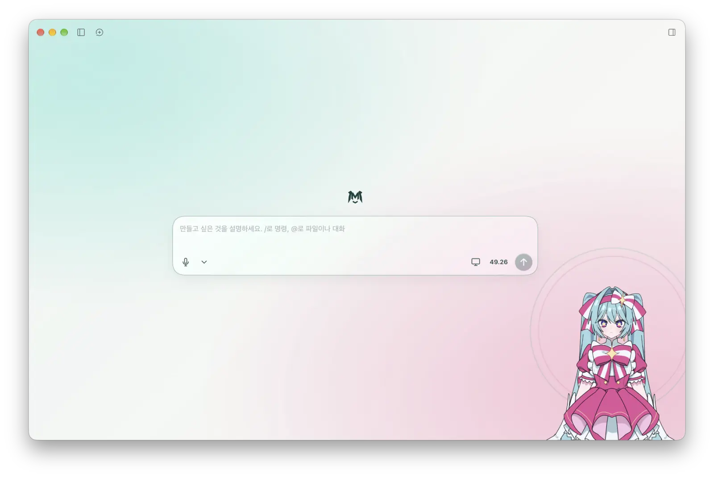

# Harness Miku · macOS · Windows · iOS

현재 소스에서 macOS는 `Install.command`, Windows는 `Install-Windows.cmd`로 설치합니다. 데스크톱 입력 옵션에서 라이트 모드를 켤 수 있습니다. 기존 Mac 설치는 앱을 종료한 뒤 `Update.command`로 업데이트할 수 있습니다.


**제작 · pbomaster, ChatGPT(OpenAI)**

DeepSeek Harness의 채팅과 작업공간에 Live2D 캐릭터를 더하는 비공식 팬 프로젝트입니다. v0.1.1 설치 키트는 기존 Harness의 모델 선택기를 사용하므로 같은 대화 UI에서 로컬 llama.cpp 모델이나 사용자가 등록한 클라우드 모델을 선택할 수 있습니다.



## 공식 다운로드 및 검증

| Windows x64 | macOS Apple Silicon | 소스 및 검증 |
| --- | --- | --- |
| [원클릭 EXE](https://github.com/pbomaster/HarnessMiku/releases/download/v0.1.1/HarnessMiku-Windows-x64-Setup.exe) · [설치 키트 ZIP](https://github.com/pbomaster/HarnessMiku/releases/download/v0.1.1/HarnessMiku-Windows-x64.zip) | [더블클릭 DMG](https://github.com/pbomaster/HarnessMiku/releases/download/v0.1.1/HarnessMiku-Mac.dmg) · [Mac 설치 키트 ZIP](https://github.com/pbomaster/HarnessMiku/releases/download/v0.1.1/HarnessMiku-Mac.zip) | [빌드 소스 ZIP](https://github.com/pbomaster/HarnessMiku/releases/download/v0.1.1/HarnessMiku-source.zip) · [SHA256SUMS.txt](https://github.com/pbomaster/HarnessMiku/releases/download/v0.1.1/SHA256SUMS.txt) |

[v0.1.1 릴리즈 및 설치 안내](https://github.com/pbomaster/HarnessMiku/releases/tag/v0.1.1) · [Windows 공개 빌드 기록](https://github.com/pbomaster/HarnessMiku/actions/workflows/release.yml)

Windows EXE는 공개 워크플로에서 빌드했으며 GitHub 빌드 출처 증명이 있습니다. Windows 게시자 서명(Authenticode)은 없습니다. 내려받은 파일은 PowerShell에서 `Get-FileHash .\HarnessMiku-Windows-x64-Setup.exe -Algorithm SHA256`, Mac에서는 `shasum -a 256 HarnessMiku-Mac.zip`으로 확인하고 위 목록과 비교하세요. GitHub CLI가 있으면 `gh attestation verify HarnessMiku-Windows-x64-Setup.exe -R pbomaster/HarnessMiku`로 EXE의 출처도 검증할 수 있습니다.

## iOS 첫 실행

1. 제작자에게서 받은 **New1007-RetrynowMiku.zip**을 압축 상태로 iPhone의 파일 앱에 저장하세요.
2. Harness Miku를 열고 **Cubism Core 이용 조건**을 확인하세요. 동의한 뒤 **모델 ZIP 선택**을 누르세요. 앱이 파일을 검증하고 기기에 저장합니다. 다음 실행부터 이 파일을 다시 사용합니다.
3. 설정에서 **DeepSeek 로그인** 또는 **API 키**를 선택하고 대화를 시작하세요. 음성 낭독은 Fish Audio를 설정한 뒤 사용할 수 있습니다.

iOS 소스는 저장소의 `iOS/` 폴더에 있습니다. [iOS 0.1.2 릴리스](https://github.com/pbomaster/HarnessMiku/releases/tag/ios-v0.1.2)에서 기기용 IPA를 제공합니다. [iOS 설정 안내](iOS/README.md)

## Windows x64 설치

1. [Windows 원클릭 설치기](https://github.com/pbomaster/HarnessMiku/releases/download/v0.1.1/HarnessMiku-Windows-x64-Setup.exe)를 다운로드하세요. 설치기가 공식 하네스에 포함된 Python을 사용합니다. Python과 Git을 별도로 설치할 필요가 없습니다.
2. 제작자의 [Ko-fi](https://ko-fi.com/s/7bb9ac0243)에서 받은 모델 ZIP을 EXE 옆에 두고 EXE를 실행하세요. ZIP이 다른 위치에 있으면 파일 선택 창이 열립니다. 기본 위치에 공식 하네스가 없으면 고정 버전 설치기를 다운로드해 해시 확인 후 설치합니다. 다른 경로의 기존 하네스를 쓰려면 ZIP 키트의 `Install-Windows.cmd "원본 폴더"`를 실행하세요.
3. 설치가 끝나면 앱이 열리며 시작 메뉴의 Harness Miku로 다시 실행할 수 있습니다. 설치 경로는 `%LOCALAPPDATA%\Programs\Harness Miku\DeepSeek Harness.exe`입니다. 원본 프로그램과 번갈아 실행하세요. 기존 데이터와 계정을 사용할 수 있습니다.
4. 한국어·영어 받아쓰기는 키트에서 `Install-Windows.cmd --speech`를 한 번 실행해 추가합니다. Fish 낭독을 사용하려면 입력 옵션을 펼치고 **Fish API 키**에서 키를 입력하세요. 저장에는 Electron의 Windows 사용자 계정 암호화를 사용합니다.

## macOS 원클릭 설치

Apple Silicon Mac(macOS 13 이상)에서 DMG를 열고 **Harness Miku Installer.app**을 실행하세요. 제작자에게 받은 모델 ZIP을 선택하면 진행 창이 뜹니다. 개발자 도구가 없으면 Apple 설치 창에서 승인이 필요합니다. 기존 앱이 있으면 종료하고 이름을 바꾼 뒤 진행하세요. 이 설치기는 임시 서명되었고 Apple 공증을 받지 않았습니다. 대안으로 아래 ZIP 설치 방법도 사용할 수 있습니다.

## macOS ZIP 설치

1. macOS 13 이상의 Apple Silicon Mac에서 진행하세요.
2. 제작자의 [공식 Ko-fi 배포 페이지](https://ko-fi.com/s/7bb9ac0243)에서 이용 조건을 읽고 원본 모델 ZIP을 직접 받으세요. `New1007-RetrynowMiku.zip`을 이 키트의 `Install.command` 옆에 두거나 설치 중 파일 선택 창에서 지정하세요.
3. 키트 ZIP을 풀고 기존 하네스를 종료한 뒤 `Install.command`를 실행하세요. 터미널에서 설치 폴더로 이동해 `bash Install.command`를 실행해도 됩니다.
4. 설치기는 DeepSeek 공식 mac-arm64 DMG(0.2.1-rc.5), 고정 커밋의 한국어 오버레이, 로컬 받아쓰기 엔진과 모델을 다운로드합니다. DMG 및 음성 다운로드의 해시와 원본 앱 서명을 검사하고 사용자 Mac에서 앱 복사본을 서명합니다. 이미 받은 DMG와 모델 ZIP 경로를 차례대로 지정하려면 `bash Install.command "/경로/New1007-RetrynowMiku.zip" "/경로/deepseek-harness-0.2.1-rc.5-mac-arm64.dmg"`를 사용하세요.
5. Finder에서 `~/Applications/Harness Miku.app`을 실행하세요. 첫 화면의 DeepSeek 계정 로그인은 원본 Harness의 기능입니다. 선택하면 브라우저에서 인증하고, 인증이 완료되면 작업공간으로 이동합니다. 직접 발급한 API 키나 로컬 모델을 사용하려면 로그인을 건너뛰고 아래 절차를 따르세요.

Python 3 또는 Git이 없으면 설치기가 Apple 개발자 도구 설치 창을 엽니다. **설치**를 누르고 터미널을 열어 두세요. 두 도구가 준비되면 같은 창에서 앱 설치가 이어집니다.

## 설치 후 설정

대화할 모델을 어디에서 실행할지 선택하세요. 클라우드 제공자의 키가 있다면 [클라우드 API 설정](#클라우드-api-설정)으로, Mac에서 GGUF 모델을 실행하려면 [로컬 AI 설정](#로컬-ai-설정)으로 이동하세요. 어느 쪽이든 Fish Audio는 음성 낭독을 원할 때만 따로 설정하면 됩니다.

### DeepSeek 계정으로 로그인

**설정 → 모델**의 아래쪽 DeepSeek 계정 영역에서 **로그인**을 누르세요. 브라우저 인증을 마치면 같은 영역에 계정 상태가 표시됩니다. 계정에서 제공하는 모델은 새 세션의 모델 선택기에서 선택하세요. 기존에 저장한 API 키나 로컬 제공자도 계속 선택할 수 있습니다.

### ChatGPT 구독으로 로그인

1. 앱에서 **설정 → 모델 → ChatGPT 구독으로 로그인**을 누릅니다. 코드가 나타나면 **OpenAI 인증 페이지 열기**를 선택하세요.
2. 본인이 시작한 요청의 코드를 OpenAI 페이지에서 입력하고 로그인과 승인을 마칩니다. 하네스가 제공하는 `openai-codex` OAuth 경로를 사용합니다. 계정에서 기기 코드 인증을 허용해야 할 수 있으며, 사용 가능 모델과 한도는 OpenAI 계정에 따릅니다.
3. 연결 완료 후 새 세션의 모델 선택기에서 **ChatGPT (Codex)** 또는 `openai-codex` 제공자의 모델을 선택하세요. 취소·만료 시 다시 시작할 수 있습니다. 코드 및 토큰은 공개 이슈에 올리지 마세요.

### 클라우드 API 설정

**DeepSeek를 사용할 때**

1. DeepSeek API 계정에서 본인의 API 키를 준비하세요. 앱의 **설정 → 모델 → DeepSeek**에서 API 키 입력란에 붙여넣고 저장합니다.
2. **새 세션**을 열고 입력창의 모델 선택기에서 DeepSeek 모델을 고릅니다.
3. “안녕, 한 문장으로 답해 줘.”를 보내 답변이 오는지 확인하세요. 인증 오류가 뜨면 같은 제공자에서 키를 다시 확인하고, 잔액 부족 오류라면 DeepSeek 계정의 API 잔액을 확인하세요.

**다른 클라우드 제공자를 사용할 때**

1. **설정 → 모델 → 모델 제공자 추가**를 열고 사용할 제공자가 목록에 있으면 선택하세요. 해당 제공자가 발급한 API 키를 입력하고 저장합니다.
2. 목록에 없는 제공자는 **사용자 지정 API**를 선택하세요. 제공자의 공식 문서에 나온 Base URL, API 프로토콜, 정확한 모델 ID를 입력하고 해당 서비스의 키를 저장합니다. 표시 이름은 모델 선택기에서 알아보기 쉬운 이름으로 정하세요.
3. 새 세션의 모델 선택기에서 방금 등록한 모델을 고른 뒤 첫 메시지를 보내세요. 메시지와 요청에 포함된 자료는 선택한 제공자에게 전송되며, 사용량은 그 계정에 청구될 수 있습니다.

### 로컬 AI 설정

DeepSeek 키 없이 시작할 수 있습니다. 첫 실행에서 로그인을 건너뛴 뒤 다음 순서로 같은 Mac에서 실행 중인 모델을 연결하세요.

llama.cpp의 **llama-server**와 Mac 메모리에 맞는 대화용 GGUF 모델을 준비하세요. 아래 경로를 실제 모델 파일 경로로 바꿔 터미널에서 실행하고, 대화하는 동안 서버를 켜 두세요. 이미 서버가 실행 중이라면 바로 1단계로 이동하세요.

```sh
llama-server -m "/경로/model.gguf" --host 127.0.0.1 --port 8080 --alias local-chat
```

1. 채팅 입력창의 화살표를 열고 **llama.cpp 연결 → 모델 확인**을 누릅니다. 서버가 다른 포트에서 실행 중이면 포트를 변경하세요. 이 기능은 루프백 주소로 모델 목록을 요청합니다.
2. **설정 → 모델 → 모델 제공자 추가 → 사용자 지정 API**에서 제공자 ID를 `llamacpp`, 주소를 `http://127.0.0.1:8080/v1`, 프로토콜을 **OpenAI Chat Completions**로 지정합니다. 반환된 모델 ID(위 예의 경우 `local-chat`)를 등록하세요.
3. 인증 없는 로컬 서버인데 키 입력이 필수라면 로컬 제공자 전용 임의 문자열 `local-only`를 사용하세요. 서버가 인증을 요구하면 서버에서 설정한 전용 키와 모델 ID를 입력하세요. DeepSeek·Fish 키를 이 칸에 넣지 마세요.
4. 새 세션의 모델 선택기에서 등록한 모델을 고르고 짧은 메시지를 보내세요. 데이터가 전달되는 주소는 이 제공자에 저장한 주소입니다. 서버를 종료하면 로컬 모델의 응답도 중단됩니다.
5. 연결이 실패하면 같은 Mac에서 `curl http://127.0.0.1:8080/v1/models`를 실행해 주소와 모델 ID를 확인하세요. 대화는 되지만 도구 호출이 실패하면 모델의 도구 지원 여부와 llama.cpp 채팅 템플릿을 확인하세요. 메뉴의 모델 조회는 실제 생성이나 도구 실행을 시험하지 않습니다.

[llama.cpp 서버 사용법](https://github.com/ggml-org/llama.cpp/tree/master/tools/server) · [Harness 모델 설정](https://github.com/deepseek-ai/deepseek-harness/blob/master/docs/user/guide/providers.md)

## 채팅과 바탕화면 미쿠

- 채팅창의 화살표를 누르면 음성, 표시 범위, 캐릭터 크기, 기본 프롬프트 등 추가 옵션이 열립니다. 모니터 아이콘으로 바탕화면 미쿠를 열 수 있습니다. 바탕화면 모드에서는 모델 아래 입력창에서 바로 대화하고 왼쪽 화살표로 작업공간과 전체 채팅을 엽니다.
- 앱과 바탕화면에서 상반신·전신 보기를 따로 저장합니다. 머리, 팔, 리본, 하단 의상과 다리에 대한 반응은 보이는 부위에 따라 달라집니다. 마우스 시선 추적, 도구 알림, 승인 요청, 파일 드롭을 지원합니다.
- 표준 모드에서 모델이 응답에 요약 표지를 작성하면 마지막 문단이 말풍선으로 표시됩니다. 클릭하거나 다음 입력을 시작하면 닫힙니다. 모델의 출력 형식에 따라 요약이 생략될 수 있습니다.
- DeepSeek를 사용하려면 설정의 DeepSeek 제공자에 본인 키를 저장하세요. 입력창의 크레딧은 DeepSeek 계정 잔액입니다. 로컬 모델에는 이 잔액이 적용되지 않습니다.

## 음성, 입 모양과 개인 정보

- 마이크 버튼으로 한국어·영어를 최대 60초간 녹음합니다. SenseVoice가 Mac에서 인식한 내용을 입력창에 넣으면 수정 후 전송하세요. 첫 설치에는 인터넷이 필요하며, 녹음 임시 파일은 처리 후 삭제됩니다.
- 선택 기능인 **미쿠 목소리 켜기**를 사용하려면 먼저 옵션의 음성 ID에 사용 권한이 있는 Fish 참조 음성 ID를 지정하세요. Fish 키는 숨김 입력창 또는 FISH_API_KEY에서 읽고 macOS 키체인 기반 암호화로 앱 바깥에 저장합니다. 음성을 켜면 낭독할 고정 대사와 대화 요약이 Fish Audio로 전송됩니다. 로컬 대화의 요약도 포함됩니다. 로컬 처리만 원하면 낭독을 끄고 외부 서비스에 접속하는 도구도 사용하지 마세요.
- 무음 말풍선은 한글·영어 모음에 맞춰 입을 움직입니다. Fish 음성이 있으면 재생 음량과 쉼에 맞추고, 발화 구간에 글자의 모음을 배분합니다. v28에서는 ‘ㅏ/a’의 입 벌림과 턱 움직임을 줄였습니다. 음소 경계는 추정값입니다.
- DeepSeek 키는 Harness의 자격 증명 저장소가 관리합니다. 설정·세션·자격 증명 파일이나 진단 로그를 공개 이슈에 첨부하지 마세요. Fish 키를 교체하려면 앱 종료 후 `~/Library/Application Support/Harness Miku/Credentials/fish-key.enc`를 삭제하고 다시 입력하세요. 환경 변수로 지정했다면 그 값도 갱신하세요.

## macOS 권한 복구

이 빌드는 전용 앱 ID와 키체인의 코드 서명 인증서를 사용합니다. 인증서가 없는 Mac에서 처음 설치하면 임시 서명을 사용하므로 다음 빌드에서 재승인이 필요할 수 있습니다. 유효한 인증서가 하나면 자동 선택하며 여러 개라면 설치·복구 때 같은 인증서를 `MIKU_SIGN_IDENTITY` 환경 변수로 지정하세요. 기존 임시 서명에서 처음 전환할 때는 새 Harness Miku에 권한을 한 번 부여해야 합니다. 작업 모드에서 Apple Events나 녹화가 거절되면 하네스가 해당 명령에 한해 전체 접근을 요청할 수 있습니다.

기존 v28 앱에서 자동화나 시스템 오디오 접근이 실패하면 앱을 완전히 종료하고 이 키트의 `Repair-Permissions.command`를 실행하세요. 기본 대상은 `~/Applications/Harness Miku.app`이며 다른 위치라면 앱 경로를 첫 인수로 전달하세요. 도구가 복사본을 수정하고 서명을 검증한 후 원래 위치에 배치하며 원본은 옆에 백업합니다. 다시 실행하여 자동화와 화면 및 시스템 오디오 녹음을 각각 확인하세요. 재서명 후 macOS에서 승인을 다시 요청할 수 있습니다. 자동화는 제어할 대상 앱마다 승인이 필요합니다.

## 업데이트와 복구

기존 앱을 종료하고 이전 앱의 이름을 바꾼 뒤 설치하세요. 원본 Harness와 설정·세션 경로를 공유하므로 한 번에 하나만 실행하세요. 업데이트 전에는 자신의 설정을 개인 위치에 백업하세요. 설치 키트는 로컬 모델을 자동으로 기본 모델로 선택하거나 개인 전역 프롬프트를 교체하지 않습니다. 앱 삭제 시 기존 데이터를 유지하려면 앱 번들만 제거하세요.

해시 불일치가 나오면 지정 버전의 원본을 다시 받으세요. 설치기는 임의의 새 업스트림 버전을 패치하지 않습니다. 이 키트는 Apple 공증을 받은 완성 앱이 아니며 실제 Mac에서 설치와 주요 기능을 확인해야 합니다.

## 배포 범위와 이용 조건

이 저장소는 설치 스크립트, UI 패치, 고정 대사와 설정 자료를 제공합니다. Live2D 모델, 완성 앱, DeepSeek 바이너리, 음원, GGUF 가중치 및 음성 엔진은 별도로 받습니다. 설치 완료 후 **모델이 포함된 앱이나 설치 디렉터리를 재배포하지 마세요**. 모델은 개인 비상업적 사용을 위한 비공식 팬 모델이며, 제작자는 미러·재업로드와 수익화 방송을 금지합니다. 자세한 조건은 [모델 공식 페이지](https://ko-fi.com/s/7bb9ac0243)를 확인하세요. 다른 구성 요소에도 각 제작자의 조건이 적용됩니다.

제3자 소프트웨어의 저작권 표시, MIT 사용권 전문 및 모델 이용 조건은 [제3자 고지](third_party_notices.md)에서 확인할 수 있습니다.

## Acknowledgements

**Inspired by**

- [いますぐ輪廻 / 지금 바로 윤회](https://youtu.be/3iUgKH8c7p4) — 음악 [なきそ](https://x.com/7kiso_nakiso), MV [channel](https://x.com/x_cast_x)
- [RetrynowMiku Live2D 팬 모델](https://ko-fi.com/s/7bb9ac0243) — 일러스트 [Ruby_呜哔うび](https://space.bilibili.com/zh-Hans/107600), Live2D 리깅 [慈善小霓](https://space.bilibili.com/zh-Hans/39488)
- [DeepSeek Harness](https://github.com/deepseek-ai/deepseek-harness) — 데스크톱 앱, 작업공간과 모델 제공자 시스템의 기반
- [noire113-dev/deepseek-harness-kr](https://github.com/noire113-dev/deepseek-harness-kr) — 한국어 오버레이와 캐릭터 통합의 기반

그 밖의 기반 프로젝트 · [llama.cpp](https://github.com/ggml-org/llama.cpp), [sherpa-onnx](https://github.com/k2-fsa/sherpa-onnx), [SenseVoice](https://github.com/FunAudioLLM/SenseVoice).
